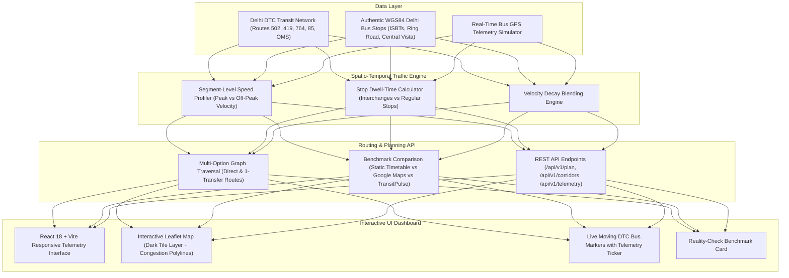

# 🚌 TransitPulse Delhi — Real-Time Bus Traffic Model & Journey Planner

[](https://delhi.transportstack.in)
[](https://delhi.transportstack.in)
[](https://whereuelevate.in)
[](https://opensource.org/licenses/MIT)

> **Built for Transport Stack Hackathon 2026 (IIIT Delhi & Where U Elevate)**  
> **Problem Statement 01:** Real-time bus traffic model and journey planner.  
> An open-source, production-grade transit intelligence engine that models Delhi's road congestion using historical and real-time DTC bus telemetry, estimating realistic bus travel times and bridging the gap between naive static schedules and ground reality.

---

## 🌟 The Core Problem & Our Solution

### The Delhi Transit Reality Gap
Traditional journey planners (and standard static schedules) assume buses travel at optimistic average speeds (25–30 km/h) and ignore dwell times. In Delhi:
1. **Severe Peak Bottlenecks:** Arterial corridors like ITO, Ring Road (AIIMS to Ashram), and Vikas Marg experience drops in bus velocity down to **7–12 km/h** during morning and evening rush hours.
2. **Stop Dwell Delays:** Heavy passenger boarding at interchange hubs (Kashmere Gate ISBT, Anand Vihar, CP, AIIMS) adds **2.5 to 3.5 minutes per major stop**.
3. **Static Schedules are Off by up to 150%:** A journey scheduled for 32 minutes actually takes 75–85 minutes in peak traffic.

### How TransitPulse Solves It
* **Segment-Level Dynamic Velocity Modeling:** Instead of global speed estimates, we model Delhi's road network as an edge-weighted directed graph where each road segment possesses a dynamic speed profile $V(s, t)$ dependent on the time-of-day.
* **Real-time GPS Decay Blending:** Live vehicle telemetry is continuously blended with historical baselines:
  $$v_{\text{effective}} = \alpha \cdot v_{\text{live}} + (1 - \alpha) \cdot v_{\text{historical}}(t)$$
* **Dwell-Time Physics Correction:** Major hubs and ordinary stops have calibrated passenger exchange dwell formulas.
* **3-Way Benchmark Reality Check:** Directly validates against static DTC timetables and private car speeds (Google Maps proxy).

---

## 🏗️ System Architecture



---

## ⚡ Quick Start & Setup Guide

### Prerequisites
* **Node.js:** v18.x or higher
* **npm:** v9.x or higher

### 1. Clone & Enter Repository
```bash
git clone https://github.com/MnDevilliars/Transport-Stack---Hackathon-2026.git
cd "Transport-Stack---Hackathon-2026"
```

### 2. Install Dependencies
```bash
# Install backend dependencies
cd server && npm install

# Install frontend dependencies
cd ../client && npm install
cd ..
```

### 3. Run the Full Stack Application
From the root directory, run:
```bash
npm start
```
* **Frontend Web App:** [http://localhost:3000](http://localhost:3000)
* **Backend REST API:** [http://localhost:5001](http://localhost:5001)
* **API Health Check:** [http://localhost:5001/health](http://localhost:5001/health)

---

## 📡 REST API Reference

### 1. Plan Journey
`POST /api/v1/plan`

**Request Payload:**
```json
{
  "originId": "STP_AIIMS",
  "destinationId": "STP_KG_ISBT",
  "departureTime": "18:30"
}
```

**Response Sample:**
```json
{
  "success": true,
  "data": {
    "origin": { "id": "STP_AIIMS", "name": "AIIMS Hospital (Ring Road)" },
    "destination": { "id": "STP_KG_ISBT", "name": "Kashmere Gate ISBT" },
    "departureTime": "18:30",
    "journeyOptions": [
      {
        "id": "OPT_DIRECT_DTC_502",
        "routeNumber": "502",
        "routeName": "Mehrauli Terminal ⇄ Kashmere Gate ISBT",
        "summary": {
          "totalDistanceKm": 18.4,
          "totalStops": 10,
          "modelEtaMinutes": 82,
          "confidenceInterval": "74 - 90 mins",
          "benchmarks": {
            "staticDtcScheduleEtaMin": 32,
            "googleMapsCarEtaMin": 34,
            "transitPulseModelEtaMin": 82,
            "scheduleUnderestimatePercentage": 156
          }
        }
      }
    ]
  }
}
```

### 2. Monitored Arterial Corridors
`GET /api/v1/corridors`
Returns real-time speeds and bottleneck warnings for Ring Road, Vikas Marg, Mathura Road, etc.

### 3. Live Bus Fleet Telemetry
`GET /api/v1/telemetry/live-buses`
Returns real-time GPS coordinates, route assignment, speed, and occupancy for active DTC buses.

---

## 📊 Phase 1 Submission Documents
* 📄 **Problem Proposal:** [PROPOSAL.md](./PROPOSAL.md)
* 📝 **Technical Note & Methodology:** [TECHNICAL_NOTE.md](./TECHNICAL_NOTE.md)
* 🎬 **Demo Video Script:** [DEMO_SCRIPT.md](./DEMO_SCRIPT.md)
* 📜 **Engineering Rules:** [PROJECT_RULES.md](./PROJECT_RULES.md)

---

## 👥 Authors & Team
* **Md Noorain Ansari** ([@MnDevilliars](https://github.com/MnDevilliars))
* Submitted for **Transport Stack Hackathon 2026** (Delhi).
